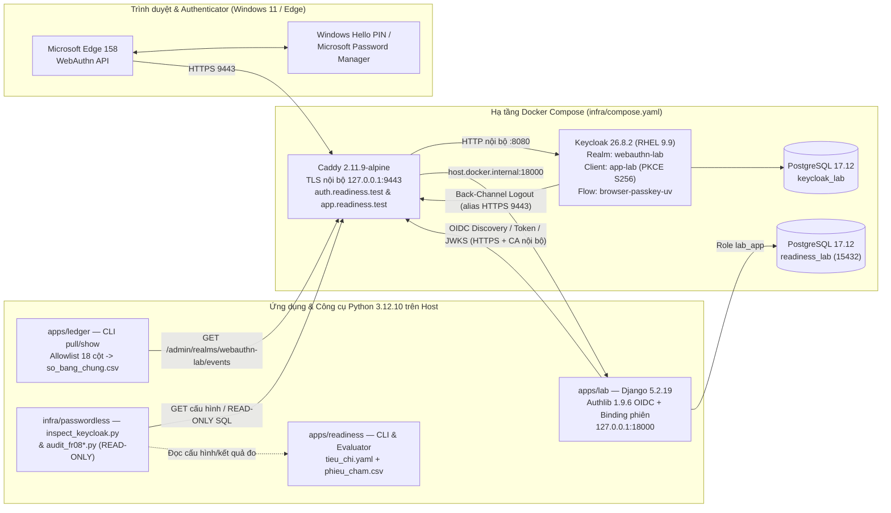
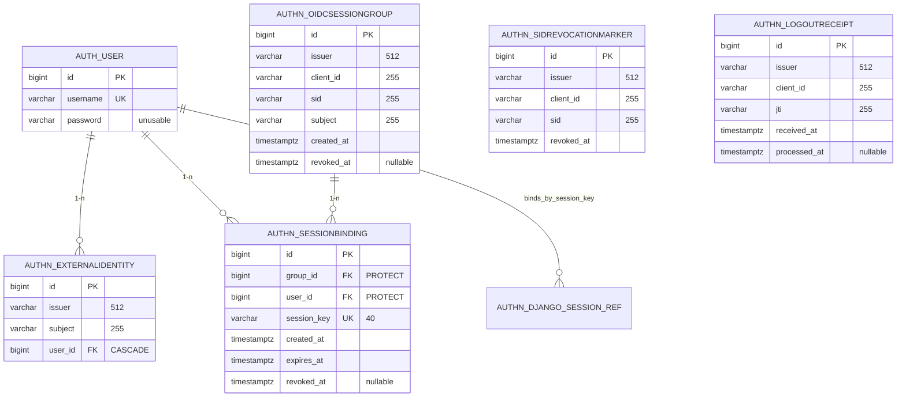
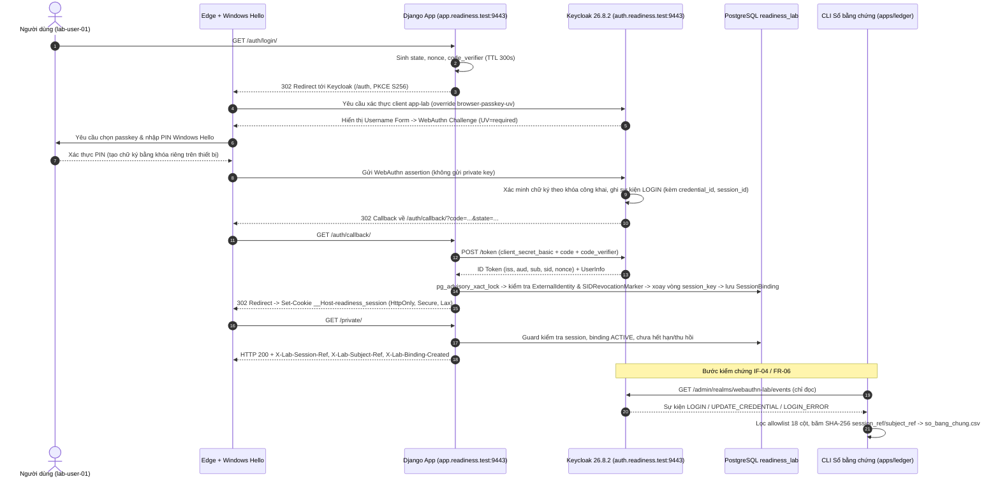

# TRƯỜNG ĐẠI HỌC CÔNG NGHỆ SÀI GÒN
**KHOA CÔNG NGHỆ THÔNG TIN**

---

## BÁO CÁO GIỮA KỲ THỰC TẬP TỐT NGHIỆP

**Đề tài:** ĐÁNH GIÁ MỨC SẴN SÀNG AN NINH VÀ KIỂM CHỨNG XÁC THỰC MẠNH WEBAUTHN/FIDO2

**Mã đặc tả:** `SRS-TTTN-N15` · **Nhóm:** Nhóm 15

| Mục | Thông tin |
| :--- | :--- |
| **Sinh viên thực hiện** | Trần Trung Hiếu — DH52300563 Đoàn Trịnh Hiếu — DH52300541 *(ngừng tham gia từ 13/11/2026 — xem Mục 5 và Mục 6)* |
| **Giảng viên hướng dẫn** | ThS. Mai Vân Phương Vũ |
| **Thời điểm báo cáo** | Giữa kỳ — hết tuần 6 / 12 |
| **Ngày nộp** | 27/11/2026 |
| **Repo / commit nộp** | `https://github.com/Keri0s/keycloak-webauthn-readiness` · nhánh `main` · commit `b91e44d` *(sẽ gắn tag `giua-ky` trên commit chốt nộp báo cáo)* |

---

## 1. Tổng quan đề tài

### 1.1 Bối cảnh và mục tiêu

Trong bối cảnh các hệ thống giáo dục đại học và cổng thông tin nội bộ như LMS, Moodle hay HEMIS đối mặt thường xuyên với nguy cơ đánh cắp thông tin đăng nhập, tấn công giả mạo (*phishing*) và lạm dụng mật khẩu dùng lại, nhu cầu chuyển dịch từ xác thực dựa trên mật khẩu truyền thống sang xác thực mạnh theo chuẩn **WebAuthn/FIDO2** (*passkey*) kết hợp với đánh giá mức độ sẵn sàng an ninh hệ thống ngày càng trở nên cấp thiết. Tuy nhiên, việc đánh giá thực tế thường thiếu một thang đo có căn cứ chuẩn quốc tế rõ ràng, đồng thời không được phép quét hay thử nghiệm trực tiếp lên hạ tầng đang vận hành của Nhà trường để tránh rủi ro gián đoạn dịch vụ và lộ lọt dữ liệu thật. Mặt khác, ngay cả khi lớp xác thực đầu vào sử dụng khóa bất đối xứng chống giả mạo, lỗ hổng hậu đăng nhập như đánh cắp định danh phiên (*Session Hijacking* / *Pass-the-Cookie*) vẫn có thể làm suy giảm hiệu lực bảo vệ nếu ứng dụng web và máy chủ định danh (*Identity Provider* — IdP) không liên kết và thu hồi phiên chặt chẽ.

Xuất phát từ bài toán đó và định hướng trao đổi với giảng viên hướng dẫn ngày 07/11/2026 (quyết định `D05`), mục tiêu của đề tài N15 gồm hai trụ cột gắn kết chặt chẽ với nhau trên môi trường **lab cục bộ hoàn toàn độc lập với dữ liệu tổng hợp**:

1. **Xây dựng bộ công cụ đánh giá mức sẵn sàng an ninh (`apps/readiness`):** Chuẩn hóa 16 tiêu chí thuộc 4 miền (`cau_hinh`, `va_loi`, `xac_thuc`, `nhat_ky`, tổng tối đa 37 điểm) tham chiếu tới **OWASP ASVS**, **NIST SP 800-63B**, **NIST SP 800-40**, **NIST SP 800-92** và **NTIA SBOM**; thực hiện kiểm tra hợp lệ điểm và nguồn bằng chứng ngắn, tính tổng điểm khách quan và kiên quyết tách biệt trạng thái *"thiếu điểm"* (chưa hoàn thành phiếu) khỏi *"điểm 0"*.
2. **Dựng cụm lab kiểm chứng xác thực mạnh WebAuthn/FIDO2 kết hợp quản lý phiên và sổ bằng chứng tối thiểu (`infra/`, `apps/lab`, `apps/ledger`):** Triển khai máy chủ định danh **Keycloak 26.8.2** cấu hình **WebAuthn Passwordless** bắt buộc *User Verification* (`UV = required`) qua HTTPS nội bộ, tích hợp với ứng dụng nghiệp vụ mẫu bằng **Django 5.2.19** thông qua giao thức **OIDC Authorization Code + PKCE (`S256`)** kèm ánh xạ và thu hồi phiên server-side, đồng thời xây dựng sổ bằng chứng bất biến chỉ giữ thời điểm, kết quả và mã định danh thông tin xác thực (*credential ID*), tuyệt đối không lưu hay hiển thị khóa riêng (*private key*) ở bất kỳ lớp nào.

Từ các mục tiêu trên, nhóm tập trung giải quyết ba câu hỏi kỹ thuật cốt lõi trong giai đoạn giữa kỳ:

- **Câu hỏi 1:** Làm thế nào để thiết kế mô hình kiểm định thang sẵn sàng sao cho minh bạch căn cứ chuẩn, không phụ thuộc quét mạng trái phép (`NFR-01`) và phản ánh trung thực cả tiêu chí đạt lẫn tiêu chí chưa đạt (`0` điểm hoặc thiếu bằng chứng) trên cụm lab thật?
- **Câu hỏi 2:** Làm thế nào để triển khai luồng đăng ký và đăng nhập passkey hoàn toàn không mật khẩu ở giao dịch thường ngày (*passwordless* với `UV = required`), gắn kết an toàn với phiên ứng dụng Django qua `sid`/`sub` để chặn chiếm đoạt hoặc tái sử dụng phiên cũ khi đăng xuất (`RP-Initiated` và `Back-Channel Logout`)?
- **Câu hỏi 3:** Làm thế nào để trích xuất bằng chứng xác thực (cả đăng ký thành công, đăng nhập thành công và hủy bỏ thất bại) từ Keycloak Events về sổ đối chiếu cục bộ mà vẫn bảo đảm nguyên tắc tối thiểu hóa dữ liệu và hoàn toàn không chứa khóa riêng ngay cả khi người xem là quản trị viên lab (`FR-08`, `NFR-04`)?

### 1.2 Phạm vi theo SRS

**Sản phẩm phải có (`SRS 1.2`):**
- Thang tiêu chí cho cấu hình, vá lỗi, xác thực và nhật ký của ứng dụng lab.
- Đăng ký và đăng nhập WebAuthn/FIDO2 trên realm lab.
- Bằng chứng mỗi lần xác thực: thời điểm, kết quả, mã thông tin xác thực.

**Ngoài phạm vi — nhóm xác nhận không làm:**
- Quét, thử cấu hình hoặc tấn công hệ thống đang vận hành của Trường.
- Gắn passkey vào Moodle, VLE hoặc HEMIS đang chạy.
- Lưu khóa riêng của passkey trên máy chủ ứng dụng.

---

## 2. Phân tích và thiết kế

### 2.1 Kiến trúc hệ thống

Hệ thống N15 được phân tách thành 4 phân hệ độc lập chạy trên một máy trạm phát triển cục bộ nhưng mô phỏng đầy đủ ranh giới tin cậy HTTPS giữa trình duyệt, reverse proxy, máy chủ định danh, ứng dụng nghiệp vụ, hai cơ sở dữ liệu tách quyền và các công cụ dòng lệnh ngoại tuyến/quản trị.

*Hình 2.1: Kiến trúc tổng thể hệ thống đánh giá sẵn sàng và lab kiểm chứng WebAuthn/FIDO2 N15.*

Bảng 2.1 tổng hợp các thành phần, công nghệ và phiên bản thực dùng đã được kiểm tra và cố định trong repository tính đến ngày `26/11/2026`.

| Thành phần | Công nghệ / Image | Phiên bản thực dùng | Vai trò & ghi chú kỹ thuật |
| :--- | :--- | :--- | :--- |
| Hệ điều hành máy chủ | Windows 11 Home Single Language | `26H2` (`OS Build 26300.9974`, x64) | Máy chạy Docker Desktop, trình duyệt và ứng dụng host |
| Trình duyệt & Authenticator | Microsoft Edge + Windows Hello | Edge `158.0.4370.33` (64-bit); Windows Hello PIN / Microsoft Password Manager | Thực thi lễ đăng ký/đăng nhập WebAuthn trên `https://auth.readiness.test:9443` |
| Container Runtime | Docker Desktop / Engine / Compose | Desktop `4.97.0`, Engine `29.9.2`, Compose `v5.6.1` (`linux/amd64`) | Điều phối 4 dịch vụ `caddy`, `keycloak`, `keycloak-db`, `app-db` |
| Reverse proxy HTTPS | `caddy` (`caddy:2.11.9-alpine`) | Caddy `2.11.9`, Alpine Linux `3.24.4` | Kết thúc TLS nội bộ cổng `9443` cho 2 tên miền `.test`; tạo CA cục bộ |
| Identity Provider (IdP) | `quay.io/keycloak/keycloak` | Keycloak `26.8.2`, OS nền RHEL `9.9 (Plow)` | Quản lý realm `webauthn-lab`, flow `browser-passkey-uv`, sự kiện User Events |
| Cơ sở dữ liệu | `postgres` (`postgres:17.12-bookworm`) | PostgreSQL `17.12`, Debian `12 (bookworm)` | Hai instance độc lập: `keycloak_lab` và `readiness_lab` (cổng host `15432`) |
| Ngôn ngữ & Engine đánh giá | Python + `PyYAML`, `pytest` | Python `3.12.10`, `PyYAML 6.0.3`, `pytest 9.2.0` | Bộ `apps/readiness` và 81 kiểm thử tự động trong `tests/` |
| Ứng dụng Lab & Sổ bằng chứng | Django + Authlib + psycopg + requests | `Django 5.2.19` (LTS), `Authlib 1.9.6`, `psycopg[binary] 3.3.9`, `requests 2.34.2`, `python-dotenv 1.2.4` *(phụ thuộc chính: `cryptography 50.0.2`, `joserfc 1.8.0`, `urllib3 2.8.0`)* | OIDC client `app-lab`, ánh xạ phiên, CLI `apps/ledger` và `inspect_keycloak.py` trong `apps/lab/.venv` |
| Rà lỗ hổng thư viện (`VA-02`) | `pip-audit` | `pip-audit 2.10.1` | Chạy trong venv tạm khi đánh giá 18 gói lab và 7 gói gốc (0 lỗ hổng) |

*Bảng 2.1: Danh mục công nghệ và phiên bản thực dùng trong đồ án N15 (đối chiếu ngày 26/11/2026).*

Trong quá trình phân tích thiết kế, nhóm giữ vững toàn bộ 20 mã yêu cầu của SRS nhưng chủ động điều chỉnh 4 điểm so với kiến trúc gợi ý trong tài liệu hướng dẫn `HD_N15` để đáp ứng định hướng bảo vệ phiên `D05` và yêu cầu chặt chẽ của WebAuthn/OIDC:

| Khía cạnh | Kiến trúc gợi ý trong `HD_N15` | Kiến trúc thực tế của nhóm N15 | Lý do kỹ thuật |
| :--- | :--- | :--- | :--- |
| Giao thức & tên miền lab | Chạy HTTPS hoặc `localhost`; chưa quy định chi tiết proxy và CA nội bộ | Bổ sung **Caddy 2.11.9** dùng TLS nội bộ tại `127.0.0.1:9443`, tách hai tên miền `.test` (`auth.readiness.test` và `app.readiness.test`), cài đặt CA tin cậy cho cả Windows, Django và container Keycloak (`network alias`) | WebAuthn yêu cầu ngữ cảnh HTTPS tin cậy có `RP ID` hợp lệ; tách hostname giúp mô phỏng đúng ranh giới RP–IdP và cho phép container Keycloak gọi *Back-Channel Logout* về ứng dụng qua HTTPS thay vì bỏ qua kiểm tra TLS |
| Ứng dụng bị chấm & quản lý phiên | Ứng dụng web nhỏ đăng nhập OIDC | **Django 5.2.19** (kế thừa chọn lọc giao diện từ `references/vdt-snapshot` nhưng tách DB/repo hoàn toàn), dùng **OIDC Authorization Code + PKCE (`S256`)** kèm 5 bảng quản lý phiên và **PostgreSQL advisory lock** | Đáp ứng chỉ đạo `D05` của GVHD về chống tấn công chiếm đoạt phiên (*Session Hijacking*): cô lập `session_key` của Django với `sid` của Keycloak, hỗ trợ *Back-Channel Logout*, *RP-Initiated Logout* và khóa đồng thời tránh xung đột callback/logout |
| Bộ trích xuất sổ bằng chứng (`IF-04`) | Gọi `/events` và gọi thêm `/users/{id}/credentials` để lấy `credential_id` | Chỉ gọi `GET /admin/realms/webauthn-lab/events` (trích trực tiếp `details.public_key_credential_id`) và tra username có cache; không đọc endpoint danh sách credentials và không theo redirect (`trust_env=False`, `allow_redirects=False`) | Thực nghiệm trực tiếp trên Keycloak `26.8.2` cho thấy sự kiện `LOGIN` và `UPDATE_CREDENTIAL` đã chứa sẵn `public_key_credential_id` trong `details`. Không đọc bảng credential giảm tối đa bề mặt tiếp xúc khóa công khai/metadata không cần thiết và tăng cường cách ly `NFR-01/NFR-04` |
| Giao diện phiếu chấm (`IF-01`) | Ứng dụng hoặc CLI nhập điểm, nguồn bằng chứng và tính tổng | Chọn **CLI chuẩn hóa (`apps/readiness/cli.py`)** kết hợp danh mục YAML và phiếu CSV | Phù hợp phạm vi SRS, dễ tái lập trên mọi máy qua một lệnh, thuận tiện tích hợp kiểm thử tự động (`81/81` test) và xuất đầu ra xác định cho bằng chứng chấm lab |

*Bảng 2.2: Đối chiếu điểm khác biệt giữa kiến trúc thực tế và gợi ý trong `HD_N15`.*

### 2.2 Thiết kế dữ liệu

**Đối chiếu với `HD_CSDL_N15` và `SRS 3.3 (DR-01…DR-04)`:** Trong bộ tài liệu dự án nhận được chỉ có `SRS_N15_San_sang_WebAuthn.docx` (Mục 3.3 quy định 4 thực thể logic `DR-01…DR-04`) và `HD_N15_San_sang_WebAuthn.docx` (Mục 5 tóm tắt `DR-01…DR-04`), không có tệp `HD_CSDL_N15` riêng biệt; đồng thời kho tham khảo VDT có 106 bảng nghiệp vụ không thuộc phạm vi đồ án. Vì vậy, nhóm đối chiếu trực tiếp thiết kế dữ liệu theo `DR-01…DR-04`:

- **Phần giữ nguyên theo SRS/HD:** Tách hoàn toàn CSDL của Keycloak (`keycloak_lab`, chứa cấu hình realm/client/event/khóa công khai WebAuthn, `secret_data` của passkey rỗng) và CSDL của ứng dụng (`readiness_lab`); giữ nguyên 4 thực thể dữ liệu tối thiểu (`Tiêu chí`, `Phiếu`, `Bằng chứng`, `Tài khoản lab`) với đúng các thuộc tính bắt buộc và nguyên tắc không lưu khóa riêng.
- **Phần bổ sung có lý do kỹ thuật (`D05` & `INV-A v1.1`):** Để giải quyết triệt để bài toán ánh xạ phiên giữa `sid` của Keycloak và `session_key` của Django trong CSDL `readiness_lab`, nhóm bổ sung 5 bảng quan hệ `authn_*` gắn kết với bảng người dùng nội bộ (`auth_user`) và bảng phiên máy chủ (`django_session`), không sao chép mật khẩu hay khóa passkey vào ứng dụng (`make_password(None)`).

*Hình 2.2: Sơ đồ thực thể quan hệ (ERD) CSDL quản lý phiên của ứng dụng lab (`readiness_lab`).*

Bảng 2.3 liệt kê đầy đủ các bảng/cấu trúc dữ liệu và những ràng buộc toàn vẹn đã được hiện thực trong mã nguồn (`apps/lab/authn/models.py`, `apps/lab/authn/transactions.py`, `apps/readiness/models.py`, `apps/ledger/schema.py`).

| Thực thể / Bảng | Thuộc tính chính | Ràng buộc đã hiện thực (PK, FK, UNIQUE, CHECK, Khóa đồng bộ) | Tham chiếu SRS |
| :--- | :--- | :--- | :--- |
| `authn_externalidentity` | `id`, `issuer`, `subject`, `user_id` | **FK** `user_id -> auth_user(id)` (`ON DELETE CASCADE`); **UNIQUE** `uq_external_identity_issuer_subject(issuer, subject)`; chính sách từ chối tự ghép user theo email | `DR-04` |
| `authn_oidcsessiongroup` | `id`, `issuer`, `client_id`, `sid`, `subject`, `created_at`, `revoked_at` | **UNIQUE** `uq_oidc_group_issuer_client_sid(issuer, client_id, sid)`; **CHECK** `oidc_group_sid_not_empty(sid <> '')`; khóa giao dịch `pg_advisory_xact_lock` theo `(issuer, client_id)` trong `authn/transactions.py` | Bổ sung theo `D05` |
| `authn_sessionbinding` | `id`, `group_id`, `user_id`, `session_key`, `created_at`, `expires_at`, `revoked_at` | **FK** `group_id -> authn_oidcsessiongroup(id)` (`PROTECT`); **FK** `user_id -> auth_user(id)` (`PROTECT`); **UNIQUE** `session_key`; **CHECK** `session_binding_key_not_empty(session_key <> '')` | Bổ sung theo `D05` |
| `authn_sidrevocationmarker` | `id`, `issuer`, `client_id`, `sid`, `revoked_at` | **UNIQUE** `uq_sid_marker_issuer_client_sid(issuer, client_id, sid)`; **CHECK** `sid_marker_sid_not_empty(sid <> '')`; ghi nhận dấu thu hồi ngay cả khi group chưa tồn tại để chặn callback đến muộn | Bổ sung theo `D05` |
| `authn_logoutreceipt` | `id`, `issuer`, `client_id`, `jti`, `received_at`, `processed_at` | **UNIQUE** `uq_logout_receipt_issuer_client_jti(issuer, client_id, jti)`; **CHECK** `logout_receipt_jti_not_empty(jti <> '')`; chống xử lý lặp / replay Logout Token | Bổ sung theo `D05` |
| `Criterion` & `Scorecard` (`tieu_chi.yaml`, `phieu_cham*.csv`) | `ma`, `nhom`, `mo_ta`, `can_cu`, `diem_toi_da`; `ngay_cham`, `nguoi_cham`, `diem`, `nguon_bang_chung` | Validate tại tầng domain & parser: đúng 4 nhóm bắt buộc, không trùng mã tiêu chí, `diem_toi_da > 0` (chặn `bool`/`float`/`NaN`/`Inf`), `0 <= diem <= diem_toi_da`, bắt buộc nguồn bằng chứng khi có điểm, ô trống không ép thành `0` | `DR-01`, `DR-02` |
| `so_bang_chung.csv` (`apps/ledger`) | 18 cột allowlist (`evidence_id`, `occurred_at_utc`, `realm`, `client_id`, `lab_account`, `operation`, `outcome`, `credential_type`, `credential_id`, `credential_label`, `uv_checked`, `registration_context`, `source_event_type`, `error_code`, `webauthn_error`, `session_ref`, `subject_ref`, `pulled_at_utc`) | Allowlist cứng tại `schema.py`: loại bỏ `ipAddress`, `sessionId` thô, `userId` thô, `code_id`, `privateKey`, `publicKey`, `attestation`; `session_ref` và `subject_ref` là mã băm **SHA-256** giới hạn phạm vi; lọc ký tự an toàn `^[A-Za-z0-9_.-]{1,80}$` cho mã lỗi; khử trùng theo `(evidence_id)` khi kéo lặp | `DR-03`, `NFR-04` |

*Bảng 2.3: Chi tiết các bảng/thực thể và ràng buộc dữ liệu đã hiện thực.*

### 2.3 Giao diện và luồng xử lý chính

Cả 4 giao diện theo đặc tả `SRS 3.1` đều đã được hiện thực và kiểm thử trên cụm lab:

| Mã IF | Giao diện (SRS 3.1) | Đã có? | Hình / đường dẫn minh họa |
| :--- | :--- | :--- | :--- |
| **IF-01** | Phiếu chấm | ☑ Có | `apps/readiness/cli.py`; đầu ra thực tế [cli-output.txt](../../docs/validation/scorecard-evidence-2026-11-26/cli-output.txt) (`27/37`); phiếu chấm [phieu_cham_lab_2026-11-26.csv](../../evidence/lab-scorecard/phieu_cham_lab_2026-11-26.csv) |
| **IF-02** | Đăng ký passkey | ☑ Có | Realm `webauthn-lab` (`webauthn-register-passwordless`); hồ sơ quan sát [report.md](../../docs/validation/passwordless-enrollment-2026-11-22/report.md) (`PL-REG-01..03`) và [registration-event-0947.md](../../docs/validation/callback-recovery-2026-11-23/registration-event-0947.md) |
| **IF-03** | Đăng nhập passkey | ☑ Có | Trang bảo vệ `/private/` trong `apps/lab/authn/views.py` + `templates/authn/private.html`; ca đối chiếu [fr05-observed-185955.md](../../docs/validation/requirements-review-2026-11-23/fr05-observed-185955.md) & [ledger-2026-11-23/report.md](../../docs/validation/ledger-2026-11-23/report.md) |
| **IF-04** | Sổ bằng chứng | ☑ Có | `apps/ledger/cli.py` (`pull`, `show`, `show --id <evidence_id>`); sổ CSV thực tế [so_bang_chung.csv](../../evidence/ledger/so_bang_chung.csv) (`67` dòng) và [nfr04-review.md](../../docs/validation/ledger-2026-11-23/nfr04-review.md) |

*Bảng 2.4: Trạng thái hiện thực các giao diện ngoài theo SRS 3.1 (`IF-01…IF-04`).*

- **IF-01 (Phiếu chấm):** Nhận đầu vào `--scorecard` (CSV) và `--evaluator`, xác thực từng tiêu chí theo `tieu_chi.yaml`, in bảng 16 tiêu chí theo 4 nhóm kèm `diem/max`, nguồn bằng chứng, trạng thái `HOÀN THÀNH` / `CHƯA HOÀN THÀNH` và tổng điểm; trả về mã thoát khác `0` khi phát hiện lỗi dữ liệu hoặc điểm vượt tối đa.
- **IF-02 (Đăng ký passkey):** Quản trị viên realm `webauthn-lab` gán required action `webauthn-register-passwordless` cho tài khoản thử `lab-user-01`; trình duyệt Edge gọi WebAuthn API dưới `RP ID = auth.readiness.test` và hoàn tất tạo passkey qua Windows Security.
- **IF-03 (Đăng nhập passkey):** Người dùng truy cập `https://app.readiness.test:9443/auth/login/`, được chuyển hướng tới flow `browser-passkey-uv` (`Username Form` + `WebAuthn Passwordless Authenticator`, `UV = required`), xác thực mã PIN Windows Hello và quay về `/private/` (`HTTP 200`, hiển thị tên người dùng, nút đăng xuất POST có CSRF và phát sinh 3 HTTP header đối chiếu `X-Lab-Session-Ref`, `X-Lab-Subject-Ref`, `X-Lab-Binding-Created`).
- **IF-04 (Sổ bằng chứng):** Lệnh `apps.ledger.cli pull` kéo các sự kiện từ Keycloak Admin REST API về `evidence/ledger/so_bang_chung.csv` (loại bỏ trùng lặp), và lệnh `show` / `show --id <evidence_id>` hiển thị thông tin đối chiếu theo allowlist 18 cột, không kèm khóa riêng hoặc định danh thô.

Hình 2.3 mô tả tuần tự luồng xử lý quan trọng nhất: **đăng nhập passkey passwordless qua OIDC/PKCE, tạo binding phiên server-side và trích xuất bằng chứng đối chiếu**.

*Hình 2.3: Sơ đồ tuần tự luồng đăng nhập Passkey Passwordless (`UV = required`), liên kết phiên Django và kéo sổ bằng chứng.*

---

## 3. Kết quả đạt được đến giữa kỳ

### 3.1 Yêu cầu chức năng

Tính đến thời điểm nộp báo cáo giữa kỳ (`27/11/2026`), toàn bộ **5/5** yêu cầu kỳ vọng giữa kỳ và **8/8** yêu cầu chức năng `FR-01…FR-08` đều đã được triển khai, kiểm thử hoặc thu thập bằng chứng quan sát thực tế trên cụm lab (trong đó có 3 hạng mục `FR-06`, `FR-07`, `FR-08` được thực hiện vượt tiến độ nửa sau):

| Mã | Tên | Mức | Phụ trách | Kỳ vọng giữa kỳ | Trạng thái | % | Bằng chứng |
| :--- | :--- | :--- | :--- | :--- | :--- | :--- | :--- |
| **FR-01** | Bộ tiêu chí | Bắt buộc | Trần Trung Hiếu | ✔ Có | ☐CB ☐ĐL ☐XC ☑XB ☐BC | 100% | `tieu_chi.yaml` (16 tiêu chí, 4 nhóm, 37 điểm); `tests/test_fr01_catalog.py`; `tests/test_readiness_regressions.py`; `evidence/FR-01/README.md` |
| **FR-02** | Chấm | Bắt buộc | Trần Trung Hiếu | ✔ Có | ☐CB ☐ĐL ☐XC ☑XB ☐BC | 100% | `apps/readiness/evaluator.py`, `parser.py`, `cli.py`; `tests/test_fr02_validation.py`; `docs/validation/scorecard-evidence-2026-11-26/cli-output.txt`; `evidence/FR-02/README.md` |
| **FR-03** | Điểm tổng | Bắt buộc | Trần Trung Hiếu | ✔ Có | ☐CB ☐ĐL ☐XC ☑XB ☐BC | 100% | `tests/test_fr03_calculator.py` (mẫu `29/37`, thiếu tiêu chí báo chưa hoàn thành); phiếu lab thực `27/37` tại `evidence/lab-scorecard/phieu_cham_lab_2026-11-26.csv`; `evidence/FR-03/README.md` |
| **FR-04** | Đăng ký passkey | Bắt buộc | Đoàn Trịnh Hiếu *(Trần Trung Hiếu thực hiện)* | ✔ Có | ☐CB ☐ĐL ☐XC ☑XB ☐BC | 95% | `docs/validation/passwordless-enrollment-2026-11-22/report.md`; `registration-event-0947.md`; 2 dòng `UPDATE_CREDENTIAL` (`52a3a562...`, `165052bf...`) trong `evidence/ledger/so_bang_chung.csv`; `evidence/FR-04/README.md` *(ảnh gốc ở hội thoại, cần chép bản che phiên vào repo)* |
| **FR-05** | Đăng nhập | Bắt buộc | Đoàn Trịnh Hiếu *(Trần Trung Hiếu thực hiện)* | ✔ Có | ☐CB ☐ĐL ☐XC ☑XB ☐BC | 95% | `apps/lab` (12 tests PASS); `inspection.json` (`browser-passkey-uv`, `UV=required`); ca thực `18:59:55` & `20:40:42` khớp `credential_id` và `X-Lab-Session-Ref` vào `/private/` 200 (`evidence/FR-05/README.md`) *(còn giữ `DEFERRED_OPEN` cho lỗi native bấm Try again)* |
| **FR-06** | Bằng chứng thành công | Bắt buộc | Đoàn Trịnh Hiếu *(Trần Trung Hiếu thực hiện)* | Nửa sau | ☐CB ☐ĐL ☐XC ☑XB ☐BC | 95% | `apps/ledger/` (13 unit tests PASS); `evidence/ledger/so_bang_chung.csv` (67 dòng: 2 đăng ký, 43 `LOGIN` có dòng `5efcdcf3...` ngày 23/11 khớp `/private/`, kéo lặp `added=0`); `docs/validation/ledger-2026-11-23/report.md`; `evidence/FR-06/README.md` |
| **FR-07** | Bằng chứng thất bại | Bắt buộc | Đoàn Trịnh Hiếu *(Trần Trung Hiếu thực hiện)* | Nửa sau | ☐CB ☐ĐL ☐XC ☑XB ☐BC | 95% | Ca hủy `14:16` (`cancel-event-1416.md`) và ca hủy `20:47:34` (`0bf7d697...`, `LOGIN_ERROR/not_allowed`, `lab_account=unknown`, `credential_id` rỗng, `/private/` HTTP 403); `apps/ledger/tests/test_mapping.py`; `evidence/FR-07/README.md` |
| **FR-08** | Không lưu khóa riêng | Bắt buộc | Đoàn Trịnh Hiếu *(Trần Trung Hiếu thực hiện)* | Nửa sau | ☐CB ☐ĐL ☐XC ☑XB ☐BC | 90% | `docs/validation/fr08-2026-11-23/report.md`, `session-review.md`, `export-review.md`: rà DB app (73 cột), DB Keycloak (`secret_data` rỗng, 67 event sạch), 461 dòng log container và 66 tệp JSON/JSONL/CSV đạt `flagged_paths=[]`; 12 unit tests công cụ `audit_fr08*.py` PASS; `evidence/FR-08/README.md` *(5 session `BadSignature` sạch marker nhưng chưa rõ nguyên nhân chữ ký)* |

| Chỉ tiêu tổng hợp FR | Kết quả |
| :--- | :--- |
| **FR kỳ vọng giữa kỳ đã XB** | **5 / 5** (`FR-01` đến `FR-05`) |
| **Tổng FR của nhóm đã XB** | **8 / 8** *(vượt kỳ vọng giữa kỳ 3 FR nửa sau: `FR-06`, `FR-07`, `FR-08`, vẫn còn bước hoàn thiện lưu ảnh che phiên vào repo ở nửa sau)* |

*Bảng 3.1: Bảng đánh giá hoàn thành 8 yêu cầu chức năng (`FR-01…FR-08`) đến giữa kỳ.*

### 3.2 Yêu cầu phi chức năng

| Mã | Yêu cầu | Trạng thái | Bằng chứng |
| :--- | :--- | :--- | :--- |
| **NFR-01** | Công cụ không có chức năng quét địa chỉ ngoài lab. | ☐CB ☐ĐL ☐XC ☑XB ☐BC | Báo cáo rà tĩnh [nfr01-02-2026-11-23/report.md](../../docs/validation/nfr01-02-2026-11-23/report.md): 0 thư viện/hàm quét mạng; điểm gọi cố định host/realm/client lab; test `test_keycloak_guard.py` và `test_inspect_keycloak.py` PASS; [evidence/NFR-01/README.md](../../evidence/NFR-01/README.md) |
| **NFR-02** | Tệp cấu hình không chứa địa chỉ cụm Keycloak đang vận hành. | ☐CB ☐ĐL ☐XC ☑XB ☐BC | Kết quả tìm kiếm tên miền Trường đạt 0 phát hiện trong [nfr01-02-2026-11-23/report.md](../../docs/validation/nfr01-02-2026-11-23/report.md); bản kiểm kê hiệu lực [20261123T135327930466Z/review.md](../../docs/validation/passwordless-preflight/20261123T135327930466Z/review.md) xác nhận dùng domain cục bộ `auth.readiness.test`; [evidence/NFR-02/README.md](../../evidence/NFR-02/README.md) |
| **NFR-03** | README đăng ký passkey, đăng nhập và mở một dòng bằng chứng. | ☐CB ☑ĐL ☐XC ☐XB ☐BC | [README.md](../../README.md) (commit `b91e44d`) đã bổ sung đầy đủ bảng phiên bản công cụ thực dùng, hướng dẫn dựng sạch 9 bước và kịch bản demo 3 bước; đã chạy thành công từng phần đăng nhập + `pull` + `show --id` (`5efcdcf3...`, `0bf7d697...`); đang chờ chạy 1 lượt demo liền mạch kèm video/ảnh vào [evidence/NFR-03/README.md](../../evidence/NFR-03/README.md) và kiểm chứng dựng trên máy sạch độc lập |
| **NFR-04** | Sổ bằng chứng không hiện khóa riêng dù người xem là quản trị lab. | ☐CB ☐ĐL ☐XC ☑XB ☐BC | Giải trình [nfr04-review.md](../../docs/validation/ledger-2026-11-23/nfr04-review.md): allowlist cứng 18 cột trong `apps/ledger/schema.py` không có tùy chọn mở rộng cho admin; rà thực tế `so_bang_chung.csv` (67 dòng) đạt 0 marker khóa riêng ([export-review.md](../../docs/validation/fr08-2026-11-23/export-review.md)); [evidence/NFR-04/README.md](../../evidence/NFR-04/README.md) |

*Bảng 3.2: Bảng đánh giá hoàn thành 4 yêu cầu phi chức năng (`NFR-01…NFR-04`).*

### 3.3 Mốc lộ trình nửa đầu

| Tuần | Việc chính (HD) | Mốc kiểm tra | Đạt? | Ghi chú / lý do lệch |
| :--- | :--- | :--- | :--- | :--- |
| **1–2** | Thang tiêu chí (bản nháp), dựng Keycloak lab + ứng dụng mẫu | `tieu_chi.yaml` nháp | ☑ Đạt ☐ Chưa | Đã hoàn tất phân tích kế thừa, chốt hướng thiết kế `D05`–`D08`, chuẩn hóa `tieu_chi.yaml` (16 tiêu chí/4 nhóm), dựng hạ tầng Docker Compose + Caddy HTTPS + Keycloak `26.8.2` + Django `5.2.19` |
| **3–4** | Trung Hiếu: FR-01, FR-02; Trịnh Hiếu: FR-04 | Passkey đăng ký được | ☑ Đạt ☐ Chưa | Từ 13/11/2026 (`D06`) Trần Trung Hiếu đảm nhiệm toàn bộ các phần việc: hoàn thành `apps/readiness` (`FR-01`, `FR-02`) kèm 81 test PASS và đăng ký thành công passkey passwordless (`UPDATE_CREDENTIAL`) cho `lab-user-01` trên realm `webauthn-lab` |
| **5–6** | Trung Hiếu: FR-03; Trịnh Hiếu: FR-05, bật Events | Đăng nhập passkey | ☑ Đạt ☐ Chưa | Hoàn thành `FR-03` và đăng nhập passkey `UV=required` qua OIDC + PKCE vào `/private/`; đã bật User Events (`7 days`) và thực hiện vượt mốc tuần 7–10 phần sổ bằng chứng (`FR-06/FR-07`, 67 dòng), rà `FR-08`, ma trận `docs/truy_vet.csv`, `README.md` dựng sạch 9 bước và chấm **phiếu lab thực tế đạt `27 / 37` điểm** ngày `26/11/2026` |

*Bảng 3.3: Đối chiếu tiến độ theo các mốc lộ trình nửa đầu (tuần 1–6).*

Ngoài mốc kiểm tra trên, ngày `26/11/2026`, tác giả đã thu thập bổ sung bằng chứng thực tế trên cụm lab (`pip-audit` `VA-02`, đối chiếu EOL + `/etc/os-release` `VA-03`, kiểm tra `Brute Force Mode` `XT-03` và `W32Time` `NK-03`) và chạy CLI chấm **phiếu đánh giá lab thực tế** (tách biệt hoàn toàn với bộ dữ liệu mẫu fixture `29/37`):

| Nhóm tiêu chí | Điểm thực tế (26/11/2026) | Điểm tối đa | Chi tiết điểm thành phần |
| :--- | :---: | :---: | :--- |
| Cấu hình an toàn (`cau_hinh`) | **8** | 10 | `CH-01=2/3`, `CH-02=2/2`, `CH-03=1/2`, `CH-04=3/3` |
| Quản lý vá lỗi (`va_loi`) | **7** | 9 | `VA-01=1/2`, `VA-02=3/3`, `VA-03=2/2`, `VA-04=1/2` |
| Xác thực an toàn (`xac_thuc`) | **6** | 10 | `XT-01=3/3`, `XT-02=2/3`, `XT-03=0/2`, `XT-04=1/2` |
| Quản lý nhật ký (`nhat_ky`) | **6** | 8 | `NK-01=3/3`, `NK-02=2/2`, `NK-03=0/1`, `NK-04=1/2` |
| **Tổng điểm sẵn sàng thực tế** | **27** | **37** | Trạng thái: **`HOÀN THÀNH` (`16/16` tiêu chí)** — [phieu_cham_lab_2026-11-26.csv](../../evidence/lab-scorecard/phieu_cham_lab_2026-11-26.csv) |

*Bảng 3.4: Kết quả chấm phiếu đánh giá mức sẵn sàng thực tế trên cụm lab ngày 26/11/2026.*

---

## 4. Kiểm thử và minh chứng

Toàn bộ kiểm thử tự động hiện chia làm hai nhóm rõ rệt (không gộp chung tỷ lệ để đảm bảo minh bạch):
1. **Bộ kiểm thử đơn vị & hồi quy ngoại tuyến (`127 ca`):** chạy hoàn toàn độc lập bằng Python `3.12.10` (`pytest 9.2.0` ở gốc và `unittest` / Django test runner trong `apps/lab/.venv`) trên Windows 11, kiểm chứng đầy đủ bộ chấm điểm readiness (`81` ca), bộ sổ bằng chứng `apps/ledger` (`13` ca), bộ kiểm kê Keycloak & rà soát `FR-08` (`21` ca) và bộ khôi phục callback/header bằng chứng của ứng dụng lab (`12` ca).
2. **Tuyến kiểm thử tích hợp phiên mở rộng (`SESSION_MAPPING_A`, `9/19 ca PASS`):** chạy trực tiếp trên PostgreSQL `readiness_lab` cho các kịch bản ánh xạ và thu hồi `OIDCSessionGroup`/`SessionBinding` (`A3, A4, A5, A7, A10, A11, A14, A15, A16`); `10` ca còn lại (`A1, A2, A6a, A6b, A8, A9a, A9b, A12, A13a, A13b`) về race condition và subject-wide logout giữ trạng thái `NOT_RUN` theo kế hoạch nửa sau.

| Chỉ số | Giá trị |
| :--- | :--- |
| **Tổng số ca kiểm thử tự động** | **127 ca ngoại tuyến** (`81` readiness + `13` ledger + `21` preflight/FR-08 + `12` Django lab). *(Ngoài ra tuyến kịch bản phiên mở rộng có `19` ca lá trong đó `9` ca đã chạy PASS trên PostgreSQL, `10` ca `NOT_RUN`)* |
| **Số ca đạt / không đạt** | **127 / 0** (`100%` đạt trong 4 bộ kiểm thử tự động ngoại tuyến; `9 PASS / 0 FAIL / 10 NOT_RUN` ở tuyến phiên mở rộng) |
| **Số ca biên / ca lỗi (dữ liệu sai, ngoài lab…)** | **99+ ca âm tính / biên** gồm: kiểm tra kiểu dữ liệu sai/vượt max/trống/trùng dòng ở `readiness` (`73` ca trong `test_fr02`, `test_fr03`, `test_readiness_regressions`); chặn cột cấm/mã lỗi lạ/giả lập không import `requests` ở `ledger` (`7` ca); phát hiện nested private JWK/PEM/`redirect`/sai `client_override` ở `infra/passwordless` (`13` ca); từ chối callback replay/hết hạn 5 phút/duplicate param/request bị chặn không lộ header ở `apps/lab` (`9` ca) |
| **Dữ liệu mẫu đã dùng (`DU_LIEU_MAU`)** | Bộ 6 tệp trong `DU_LIEU_MAU/N15_San_sang_WebAuthn/`: `tieu_chi.yaml`, `phieu_cham_mau_day_du.csv`, `phieu_cham_mau_thieu.csv`, `phieu_cham_loi_vuot_diem.csv`, `so_bang_chung_mau.csv`, `realm/webauthn-lab-realm.json` |
| **Lệnh chạy kiểm thử** | • `python -m pytest tests -q` *(81 passed)* • `.\apps\lab\.venv\Scripts\python.exe -m unittest discover -s apps/ledger/tests -t . -v` *(13 ok)* • `.\apps\lab\.venv\Scripts\python.exe -m unittest discover -s infra/passwordless -p "test_*.py" -v` *(21 ok)* • `.\apps\lab\.venv\Scripts\python.exe apps\lab\manage.py test authn.test_oidc_recovery authn.test_login_evidence -v 2` *(12 ok)* • Chấm phiếu lab thực: `python -m apps.readiness.cli --scorecard evidence/lab-scorecard/phieu_cham_lab_2026-11-26.csv --evaluator "Trần Trung Hiếu" --date 2026-11-26` |
| **Link video demo giữa kỳ (≤ 3 phút)** | `[Sinh viên điền URL video quay 3 bước demo theo README.md trước khi nộp]` |

*Bảng 4.1: Tổng hợp số liệu kiểm thử tự động, dữ liệu mẫu và lệnh tái lập.*

Bảng 4.2 trình bày 12 ca kiểm thử và quan sát thực tế tiêu biểu phủ toàn bộ `FR-01…FR-08`, `NFR-01…NFR-04` và tuyến bảo vệ phiên `D05`:

| Mã ca | FR/NFR | Mô tả ngắn | Kết quả mong đợi | Kết quả thực tế |
| :--- | :--- | :--- | :--- | :--- |
| **TC-FR01-01** | FR-01 | `test_load_official_sample_catalog` & `test_reject_catalog_missing_group` | Nạp đủ 16 tiêu chí/4 nhóm; từ chối catalog thiếu nhóm hoặc sai kiểu `diem_toi_da` | PASS (81/81 tests readiness PASS; 10/10 SHA-256 nguồn khớp `run-metadata.json`) |
| **TC-FR02-01** | FR-02 | Nạp `phieu_cham_loi_vuot_diem.csv` qua `CLI` & `test_reject_official_error_sample_csv` | Chặn điểm vượt tối đa, số âm, thiếu nguồn bằng chứng và thoát với mã lỗi | PASS (`exit_code = 2`, từ chối ghi điểm vượt max; `phieu_cham_lab_2026-11-26.csv` hợp lệ) |
| **TC-FR03-01** | FR-03 | Tính điểm trên `phieu_cham_mau_day_du.csv`, `phieu_cham_mau_thieu.csv` và `phieu_cham_lab_2026-11-26.csv` | Mẫu đủ ra `29/37`, mẫu thiếu `NK-03/NK-04` báo `CHƯA HOÀN THÀNH`; lab thực `16/16` ra kết quả chính xác | PASS (mẫu `29/37`; thiếu `CHƯA HOÀN THÀNH`; phiếu lab thực `26/11/2026` đạt `HOÀN THÀNH` `27/37`) |
| **TC-FR04-01** | FR-04 | Đăng ký passkey cho `lab-user-01` trên realm `webauthn-lab` (`webauthn-register-passwordless`) | Tạo credential loại `webauthn-passwordless` gắn với RP ID `auth.readiness.test`, có dòng `UPDATE_CREDENTIAL` | ĐẠT (`UPDATE_CREDENTIAL` ngày 22/11 `52a3a562...` và 23/11 `165052bf...`, nhãn `Edge-Passkey`, `credential_id=gGCUOjoWoGQwWgLe3SMDow`) |
| **TC-FR05-01** | FR-05 | Đăng nhập mới `lab-user-01` qua flow `browser-passkey-uv` (`UV=required`) và vào `/private/` | Nhập PIN Windows Hello, callback OIDC + PKCE tạo `SessionBinding`, `/private/` trả HTTP `200` với 3 header đối chiếu | ĐẠT có ghi nhận lỗi lặp (`18:59:55` & `20:40:42` HTTP `200`, khớp `X-Lab-Session-Ref` và `credential_id`; giữ `DEFERRED_OPEN` lỗi native bấm *Try again*) |
| **TC-FR06-01** | FR-06 | `apps.ledger.cli pull` sau lượt `LOGIN` `20:40:42` và chạy `pull` lặp ngay sau đó | Lần pull đầu thêm đúng 1 dòng thành công (`added=1`) khớp `session_ref`; lần pull lặp thêm `added=0` | PASS (lần 3: `added=1, total=66`, dòng `5efcdcf3...`; lần 4 lặp: `added=0, duplicates=43, total=66`; 13 unit tests `apps/ledger` PASS) |
| **TC-FR07-01** | FR-07 | Hủy hộp thoại passkey (`20:47:34`), `pull` sổ và thử mở `/private/` | Keycloak ghi `LOGIN_ERROR/not_allowed`, sổ thêm 1 dòng thất bại với `lab_account=unknown`, `credential_id` rỗng, `/private/` trả `403` | PASS (`0bf7d697...` ghi `outcome=failure`, `error_code=not_allowed`, sạch IP/`code_id`/mô tả thô; `/private/` trả `403 Forbidden`) |
| **TC-FR08-01** | FR-08 | Chạy `audit_fr08_exports.py`, `fr08-keycloak.sql`, `audit_fr08_logs.py` & `audit_fr08_sessions.py` | DB, log và 66 tệp JSON/JSONL/CSV không có trường khóa riêng (`PRIVATE KEY` / JWK `d`) | PASS có giới hạn (`0` marker trên DB app, DB Keycloak `secret_data` rỗng, 461 dòng log, 66 tệp export; 5 session `BadSignature` sạch marker nhưng chưa rõ nguồn chữ ký) |
| **TC-NFR01-01** | NFR-01 | `test_client_enforces_lab_ca_no_trust_env_no_redirects_and_path_guard` & rà tĩnh repo | Không thư viện quét mạng; chặn đường dẫn ngoài `/admin/realms/webauthn-lab`, tắt proxy và redirect | PASS (21 unit tests `infra/passwordless` + `apps/ledger` PASS; rà tĩnh 23/11 đạt 0 hàm quét mạng) |
| **TC-NFR02-01** | NFR-02 | Grep tên miền Trường (`stu.edu`, `hutech`, `.edu.vn`) & chạy `inspect_keycloak.py` | 0 tên miền Trường trong repo; `inspection.json` chỉ dùng `auth.readiness.test` và `app.readiness.test` | PASS (`0` kết quả tên miền Trường; `inspection.json` `13:53:27Z` xác nhận `app-lab` override `browser-passkey-uv`, `UV=required`) |
| **TC-NFR04-01** | NFR-04 | `test_save_and_load_drop_disallowed_columns_including_private_key` & `cli show` | Cột ngoài allowlist 18 cột (kể cả `private_key`) bị loại bỏ khi ghi và khi hiển thị, kể cả quyền quản trị | PASS (`nfr04-review.md` & `test_store.py`/`test_cli_show.py` PASS; `so_bang_chung.csv` thực tế sạch marker) |
| **TC-SESS-A14/A16** | Phiên (`D05`) | `tmp/check_a14.py` & `tmp/check_a16.py` (Authlib thật + PostgreSQL `readiness_lab`) | Từ chối callback thiếu/rỗng `sid`; từ chối Back-Channel Logout đúng `sid` nhưng sai chủ `sub` | PASS (`9/19` ca lá tuyến phiên đạt PASS trong `WORKFLOW-STATE.md` ngày 18/11) |

*Bảng 4.2: Các ca kiểm thử và quan sát thực tế tiêu biểu (môi trường Windows 11 + Docker Compose + Python 3.12.10).*

---

## 5. Đóng góp của từng thành viên

Theo `SRS 4.2`, nhóm đăng ký ban đầu gồm 2 thành viên. Tuy nhiên từ ngày **13/11/2026** (quyết định `D06`), sinh viên **Đoàn Trịnh Hiếu (DH52300541)** không tiếp tục tham gia thực hiện đề tài; sinh viên **Trần Trung Hiếu (DH52300563)** đã đảm nhiệm toàn bộ cả hai phần việc (bộ tiêu chí `FR-01…FR-03`, hạ tầng/WebAuthn lab `FR-04…FR-08`, ứng dụng bảo vệ phiên `apps/lab` và toàn bộ tài liệu đối chiếu).

| Sinh viên | Phần việc theo SRS 4.2 | Đã làm đến giữa kỳ | Số commit | Tự đánh giá (%) |
| :--- | :--- | :--- | :---: | :---: |
| **Trần Trung Hiếu** (`DH52300563`) | Thang tiêu chí, phiếu chấm, điểm tổng (`FR-01`, `FR-02`, `FR-03`) — *thực tế đảm nhiệm toàn bộ `FR-01…FR-08`, `NFR-01…NFR-04`, `IF-01…IF-04`, `DR-01…DR-04` sau `D06`* | Xây dựng hoàn chỉnh `apps/readiness` (81 tests PASS), hạ tầng Docker/Caddy/Keycloak passwordless, ứng dụng OIDC Django + bảo vệ phiên (12 tests PASS + 9/19 ca phiên), sổ bằng chứng `apps/ledger` (13 tests PASS + 67 dòng live), rà soát `FR-08`/`NFR-01..04`, hoàn thiện `README.md` dựng sạch 9 bước và chấm phiếu lab thực `27/37` | **6** *(tác giả Git: `Kerios`)* | **90%** *(còn hoàn thiện video/demo liền mạch `NFR-03`, ảnh che phiên vào `evidence/` và chạy thử máy sạch)* |
| **Đoàn Trịnh Hiếu** (`DH52300541`) | WebAuthn trên Keycloak lab và sổ bằng chứng (`FR-04` đến `FR-08`) | Không có đóng góp mã nguồn, cấu hình hay bằng chứng thực hiện trong giai đoạn giữa kỳ (đã ghi nhận chuyển đổi sang đồ án cá nhân trong `docs/decision-log.md` mục `D06` ngày 13/11/2026) | **0** | **0%** |

*Bảng 5.1: Bảng đóng góp và số liệu commit thực tế trích xuất từ `git shortlog -sn --all` (`6 Kerios`).*

---

## 6. Khó khăn, rủi ro và điều chỉnh

### 6.1 Các vấn đề, khó khăn và rủi ro phát sinh

| Vấn đề / rủi ro | Ảnh hưởng (FR, mốc) | Đã xử lý thế nào | Cần hỗ trợ | Mức |
| :--- | :--- | :--- | :--- | :---: |
| **Khuyết 1 thành viên (`D06`)** — Đoàn Trịnh Hiếu ngừng tham gia từ 13/11/2026 | Tác động trực tiếp tiến độ tuần 3–10 vì 1 người phải gánh cả thang sẵn sàng lẫn Keycloak WebAuthn/sổ bằng chứng | Trần Trung Hiếu tiếp quản toàn bộ `FR-01…FR-08`, giữ nguyên các yêu cầu bắt buộc của SRS (không cắt bớt phạm vi) và đến 26/11 đã đuổi kịp cả mốc nửa sau (`FR-06..08`, phiếu thực `27/37`) | Xin GVHD xác nhận chính thức chuyển phân công cá nhân cho Nhóm 15 trong biên bản giữa kỳ | ☐T ☐TB ☑C |
| **Lỗi hộp thoại Windows Security chập chờn phải bấm *Try again*** (`DEFERRED_OPEN`) | `FR-05`, `IF-03`, trải nghiệm đăng nhập | Đã khoanh vùng qua Network & Event Viewer (`PL-NET-01`, `PL-WIN-01`): lỗi xảy ra nội bộ trước khi trình duyệt gửi assertion về Keycloak, không phải lỗi server/JWT và không liên quan lỗ hổng NTLM tháng 11/2026 (`CVE-2026-118737`). Đang tách biệt ca lỗi với ca thành công trong báo cáo; nửa sau sẽ đối chứng bằng Windows Hello cục bộ thay cho plugin `Microsoft Password Manager` | Trao đổi với GVHD mức độ chấp nhận workaround/đối chứng theo thiết bị lab Windows 11 26H2 | ☐T ☑TB ☐C |
| **5 bản ghi `django_session` báo `BadSignature`** | `FR-08` (tính toàn vẹn kho phiên) | Đã viết bộ giải mã an toàn kiểm tra dữ liệu không tin cậy (`audit_fr08_sessions.py`): giải nén đọc payload JSON của cả 5 dòng xác nhận **0 marker khóa riêng**; 4 dòng đã hết hạn, 1 dòng chưa hết hạn không có `SessionBinding`. Không xóa dấu vết; giữ trạng thái chưa rõ nguồn sinh chữ ký cũ | Không bắt buộc hỗ trợ; tiếp tục giữ nguyên dấu vết để báo cáo trung thực ở cuối kỳ | ☑T ☐TB ☐C |
| **Hai tiêu chí `XT-03 = 0/2`, `NK-03 = 0/1` trên lab thật & quy trình dựng sạch 9 bước chưa test trên máy thứ hai** | `NFR-03` (`Chung-01`), điểm sẵn sàng `27/37` | Chấm đúng thực tế `27/37` thay vì tô đẹp bằng điểm mẫu `29/37`; đã ghi nhận chính xác `Brute Force Mode: Disabled` và dịch vụ `W32Time` chưa chạy; đã hoàn tất hướng dẫn dựng sạch 9 bước (thứ tự Caddy CA → `bootstrap-admin` → `lab_app`) trong `README.md` | Cần mượn/dùng thêm một máy Windows sạch ở tuần 9–10 để kiểm chứng thực tế quy trình dựng 9 bước | ☐T ☑TB ☐C |
| **Keycloak `eventsExpiration = 604800` (7 ngày)** | `FR-06`, `FR-07`, `NK-04` | Triển khai `apps/ledger` lưu bền vững sự kiện về `evidence/ledger/so_bang_chung.csv` kèm `pull-log.jsonl` chống trùng, giúp bằng chứng không mất khi Keycloak xoay vòng sự kiện sau 7 ngày | Duy trì thói quen `pull` ngay sau mỗi đợt kiểm thử lab | ☑T ☐TB ☐C |

*Bảng 6.1: Khó khăn, rủi ro thực tế và phương án xử lý trong nửa đầu.*

### 6.2 Kiểm soát các rủi ro đã biết của đề tài (HD `Sai lầm thường gặp`)

| Rủi ro | Nhóm đã kiểm soát? | Cách kiểm soát |
| :--- | :--- | :--- |
| Dùng nmap/quét để 'thu bằng chứng' cho tiêu chí. | ☑ Có ☐ Chưa | Toàn bộ mã nguồn `apps/readiness`, `apps/ledger`, `apps/lab`, `infra/passwordless` không import bất kỳ công cụ quét mạng nào (`NFR-01`); bằng chứng phiếu chấm được lấy hoàn toàn từ cấu hình tĩnh, `pip-audit`, `/etc/os-release`, `w32tm`, `inspect_keycloak.py` và `so_bang_chung.csv`. |
| WebAuthn không chạy vì truy cập bằng IP qua HTTP. | ☑ Có ☐ Chưa | Dùng Caddy `2.11.9` cấp chứng chỉ TLS nội bộ cho tên miền cục bộ `https://auth.readiness.test:9443` và `https://app.readiness.test:9443`, cấu hình `hosts` Windows, cài Trusted Root CA và đặt `RP ID = auth.readiness.test`. |
| Ghi 'publicKey'/'attestationObject' đầy đủ vào sổ bằng chứng. | ☑ Có ☐ Chưa | `apps/ledger/schema.py` khóa cứng allowlist 18 cột, chỉ ghi `credential_id`, `credential_type`, `credential_label`, `uv_checked`; loại bỏ toàn bộ `publicKey`, `attestationObject`, `signature`, `clientDataJSON`, `privateKey`, IP và `sessionId` thô (`NFR-04`). |
| Thang tiêu chí không có căn cứ. | ☑ Có ☐ Chưa | Mỗi tiêu chí trong `tieu_chi.yaml` gắn rõ căn cứ chuẩn (OWASP ASVS V2/V3/V7/V9/V14, NIST SP 800-63B/40/92/218, NTIA SBOM, WebAuthn L2, OIDC Core); phần kiểm chứng thực tế giải trình chi tiết theo từng mã tại `evidence/lab-scorecard/ghi_chu_tieu_chi.md`. |

*Bảng 6.2: Đối chiếu kiểm soát 4 sai lầm thường gặp theo hướng dẫn HD_N15.*

### 6.3 Đề xuất thay đổi / xác nhận yêu cầu (SRS 4.2 & 4.3)

| Mã yêu cầu | Nội dung cũ | Nội dung mới (đề xuất / xin xác nhận) | Lý do |
| :--- | :--- | :--- | :--- |
| **SRS 4.2 (Phân công)** | Trần Trung Hiếu (`FR-01..FR-03`) và Đoàn Trịnh Hiếu (`FR-04..FR-08`) cùng thực hiện | Xác nhận chuyển phân công thành đề tài cá nhân: **Trần Trung Hiếu (DH52300563)** phụ trách toàn bộ `FR-01…FR-08`, `NFR-01…NFR-04`, `IF-01…IF-04`, `DR-01…DR-04` | Thành viên Đoàn Trịnh Hiếu ngừng tham gia từ ngày 13/11/2026 (`D06`); sinh viên còn lại đã đảm nhiệm trọn vẹn và giữ nguyên 100% yêu cầu bắt buộc |
| **Bổ sung kỹ thuật (`D05`)** | Ứng dụng web nhỏ đăng nhập qua OIDC | Giữ nguyên mã `FR-01…FR-08`, bổ sung lớp ánh xạ phiên server-side (`OIDCSessionGroup`, `SessionBinding`, `SIDRevocationMarker`, `LogoutReceipt`) qua OIDC + PKCE `S256` và `Back-Channel Logout` | Thực hiện theo định hướng trực tiếp của GVHD ngày 07/11/2026 (`D05`) nhằm đối phó rủi ro *Session Hijacking* hậu đăng nhập |

*Bảng 6.3: Đề xuất cập nhật phân công và xác nhận định hướng kỹ thuật trình GVHD.*

---

## 7. Kế hoạch nửa sau (tuần 7–12)

Mặc dù phần lớn chức năng cốt lõi `FR-01…FR-08` và chấm phiếu lab thực `27/37` đã hoàn thành sớm trong tuần 5–6, nửa sau sẽ tập trung **đóng dứt điểm `NFR-03`**, hoàn thiện bằng chứng ảnh độc lập, đối chứng lỗi native Windows, cải thiện các tiêu chí lab còn mất điểm và mở rộng kiểm thử phiên nâng cao:

| Tuần | Kế hoạch gốc | Mốc kiểm tra | Kế hoạch của nhóm | Người làm |
| :--- | :--- | :--- | :--- | :--- |
| **7–8** | Trịnh Hiếu: sổ bằng chứng `FR-06`, `FR-07` | Có dòng thành công và thất bại | *(Đã hoàn tất `apps/ledger` + 67 dòng live ở tuần 6)*. Bổ sung trong tuần 7–8: **(1)** Quay video & chạy 1 lượt demo liền mạch từ đầu tới cuối theo `README.md` (`NFR-03`), lưu bộ ảnh đã che phiên/IP/`code_id` vào `evidence/FR-04/…evidence/NFR-03/`; **(2)** Đối chứng lỗi *Try again* bằng Windows Hello cục bộ (tách khỏi plugin `Microsoft Password Manager`) và bắt mã lỗi `WebAuthN/Operational` nếu tái hiện | Trần Trung Hiếu |
| **9–10** | Chấm ứng dụng lab bằng phiếu (dùng bằng chứng WebAuthn), `FR-08`, `README` | Phiếu mẫu đủ 4 nhóm | *(Đã chấm phiếu thực `27/37` và hoàn tất `README.md` 9 bước ở tuần 6)*. Bổ sung trong tuần 9–10: **(1)** Chạy kiểm chứng thực tế quy trình dựng sạch 9 bước trên một máy Windows mới độc lập và chấm lại bằng `phieu_cham_lab_draft.csv`; **(2)** Bật *Brute force detection* (`XT-03`), khởi động `W32Time` (`NK-03`), bổ sung HTTP security headers ở Caddy (`CH-03`) để tái chấm và so sánh điểm sẵn sàng trước–sau cải thiện; **(3)** Triển khai thêm phần còn thiếu của 10 ca `SESSION_MAPPING_A` (concurrency `A6/A9a` & subject-wide logout cutoff) | Trần Trung Hiếu |
| **11–12** | Nghiệm thu, báo cáo | Hồ sơ nghiệm thu | Đóng gói hoàn chỉnh hồ sơ nghiệm thu (`evidence/nghiem_thu.md`, `docs/truy_vet.csv`, bộ báo cáo `docs/validation/`), chạy lại toàn bộ 127+ kiểm thử hồi quy sau mọi chỉnh sửa cuối cùng, rà sạch `FR-08` / `NFR-01..04`, hoàn thiện báo cáo tổng kết đồ án tốt nghiệp và chuẩn bị demo bảo vệ | Trần Trung Hiếu |

*Bảng 7.1: Kế hoạch thực hiện chi tiết cho nửa sau (tuần 7–12).*

---

## 8. Tự đánh giá

| Tiêu chí | Điểm tối đa | Nhóm tự chấm | Căn cứ |
| :--- | :---: | :---: | :--- |
| Mức hoàn thành so với kế hoạch giữa kỳ | 3.0 | **2.8** | Đạt `5/5` FR kỳ vọng giữa kỳ (`FR-01…FR-05`), đồng thời hoàn thành vượt tiến độ nửa sau phần sổ bằng chứng (`FR-06`, `FR-07`), rà soát `FR-08` và chấm phiếu lab thực `27/37`; trừ nhẹ `0.2` do chưa hoàn tất quay video demo liền mạch cho `NFR-03` |
| Phân tích – thiết kế (kiến trúc, CSDL, bám SRS) | 2.0 | **1.8** | Bám sát 20 mã SRS (`FR/NFR/IF/DR`), thiết kế tách biệt proxy HTTPS/IdP/app/2 DB kèm 5 bảng quản lý phiên (`4 UniqueConstraint`, `4 CheckConstraint`, advisory lock PostgreSQL) và đối chiếu minh bạch lý do kỹ thuật |
| Kiểm thử và bằng chứng | 2.0 | **1.7** | Đạt `127/127` kiểm thử tự động ngoại tuyến (`81 + 13 + 21 + 12`), `9/19` kịch bản phiên PostgreSQL, 67 dòng sổ bằng chứng thật, `pip-audit` + `/etc/os-release`; trừ `0.3` do ảnh gốc chưa chép hết từ hội thoại vào thư mục `evidence/` và lỗi native *Try again* còn `DEFERRED_OPEN` |
| Kế hoạch nửa sau và quản lý rủi ro | 1.0 | **0.9** | Nhận diện trung thực và xử lý có bằng chứng 5 rủi ro thực tế (`D06`, *Try again*, 5 session `BadSignature`, `XT-03/NK-03=0`, TTL 7 ngày) cùng toàn bộ 4 sai lầm thường gặp trong HD; kế hoạch tuần 7–12 cụ thể |
| Báo cáo và trình bày | 1.0 | **0.8** | Đúng mẫu báo cáo giữa kỳ của GVHD, trích dẫn chuẩn IEEE, số liệu nhất quán với commit `b91e44d` trên GitHub; còn cần bổ sung link video demo ≤ 3 phút |
| Đóng góp cá nhân và làm việc nhóm | 1.0 | **0.5** | Ghi nhận trung thực: Trần Trung Hiếu chủ động gánh toàn bộ khối lượng của nhóm 2 người sau khi Đoàn Trịnh Hiếu ngừng tham gia từ 13/11/2026 (`D06`), tuy nhiên theo tiêu chí làm việc nhóm không đủ 2 thành viên cùng đóng góp |
| **Tổng** | **10.0** | **8.5** | *(Điểm tự chấm đề xuất phản ánh tiến độ thực tế và những điểm còn tồn đọng tính đến 27/11/2026)* |

*Bảng 8.1: Bảng tự đánh giá của sinh viên (thang 10.0).*

---

## 9. Đánh giá của giảng viên hướng dẫn

| Tiêu chí | Tối đa | Chưa đạt | Đạt | Khá | Giỏi | Điểm |
| :--- | :---: | :--- | :--- | :--- | :--- | :---: |
| Mức hoàn thành so với kế hoạch giữa kỳ | 3.0 | < 50% FR kỳ vọng có bằng chứng | 50–74% | 75–99% | 100% FR kỳ vọng có bằng chứng, có phần vượt kế hoạch | |
| Phân tích – thiết kế (kiến trúc, CSDL, bám SRS) | 2.0 | Thiết kế thiếu hoặc lệch SRS | Có ERD/kiến trúc cơ bản | Đầy đủ, có ràng buộc và lý do thiết kế | Đầy đủ, có so sánh phương án, ràng buộc kiểm chứng được | |
| Kiểm thử và bằng chứng | 2.0 | Không có kiểm thử tự động | Có kiểm thử cho một phần FR | Kiểm thử chạy một lệnh, đặt tên theo FR | Có ca biên/ca lỗi, chạy trong CI, có số liệu | |
| Kế hoạch nửa sau và quản lý rủi ro | 1.0 | Không có kế hoạch cụ thể | Có kế hoạch, chưa gắn rủi ro | Kế hoạch theo tuần, nêu rủi ro | Kế hoạch khả thi, rủi ro có phương án dự phòng | |
| Báo cáo và trình bày | 1.0 | Sai mẫu, thiếu mục | Đủ mục, trình bày chưa rõ | Rõ ràng, có hình/bảng minh họa | Mạch lạc, trích dẫn IEEE đúng, trả lời câu hỏi tốt | |
| Đóng góp cá nhân và làm việc nhóm | 1.0 | Không chứng minh được đóng góp | Đóng góp có nhưng không đều | Đóng góp rõ theo phân công | Đóng góp rõ, hỗ trợ thành viên/nhóm liên quan | |
| **Tổng điểm nhóm** | **10.0** | | | | | |

| Sinh viên | Điểm cá nhân (nếu khác điểm nhóm) | Lý do |
| :--- | :--- | :--- |
| Trần Trung Hiếu | | |
| Đoàn Trịnh Hiếu | | |

| Mục đánh giá | Nội dung |
| :--- | :--- |
| **Kết luận** | ☐ Đạt — tiếp tục theo kế hoạch ☐ Tiếp tục có điều kiện — bổ sung trước tuần ___: ____________ ☐ Cần điều chỉnh phạm vi / cảnh báo tiến độ |
| **Nhận xét** | |
| **Ngày, chữ ký** | |

---

## Tài liệu tham khảo

[1] Phòng Công nghệ thông tin, "Đánh giá mức sẵn sàng an ninh và kiểm chứng xác thực mạnh WebAuthn/FIDO2," Đặc tả yêu cầu phần mềm SRS-TTTN-N15, phiên bản 0.9, 25/10/2026.

[2] W3C, "Web Authentication: An API for accessing Public Key Credentials Level 2," W3C Recommendation, 2021.

[3] FIDO Alliance, "Client to Authenticator Protocol (CTAP)." [Online]. Available: https://fidoalliance.org/specifications/ (truy cập ngày 26/11/2026).

[4] Phòng Công nghệ thông tin, "Hướng dẫn thực hiện đề tài: Đánh giá mức sẵn sàng an ninh và kiểm chứng xác thực mạnh WebAuthn/FIDO2," HD-TTTN-N15 (căn cứ SRS-TTTN-N15 v0.9), 05/11/2026.

[5] P. A. Grassi, M. E. Garcia, and J. L. Fenton, "Digital Identity Guidelines: Authentication and Lifecycle Management," NIST Special Publication 800-63B, Jun. 2017. [Online]. Available: https://pages.nist.gov/800-63-3/sp800-63b.html (truy cập ngày 26/11/2026).

[6] OWASP Foundation, "Application Security Verification Standard (ASVS)." [Online]. Available: https://owasp.org/www-project-application-security-verification-standard/ (truy cập ngày 26/11/2026).

[7] Keycloak Project, "Keycloak 26.8.2 Server Administration Guide — W3C Web Authentication (WebAuthn) and Admin REST API." [Online]. Available: https://www.keycloak.org/docs/26.8.2/server_admin/index.html (truy cập ngày 26/11/2026).

[8] M. Jones and J. Bradley, "OpenID Connect Back-Channel Logout 1.0," OpenID Foundation, Dec. 2023. [Online]. Available: https://openid.net/specs/openid-connect-backchannel-1_0.html (truy cập ngày 26/11/2026).

[9] M. Jones, N. Sakimura, and T. Lodderstedt, "OpenID Connect RP-Initiated Logout 1.0," OpenID Foundation, Sep. 2022. [Online]. Available: https://openid.net/specs/openid-connect-rpinitiated-1_0.html (truy cập ngày 26/11/2026).

[10] Django Software Foundation, "Django 5.2 Documentation — How to use sessions & Testing tools." [Online]. Available: https://docs.djangoproject.com/en/5.2/topics/http/sessions/ (truy cập ngày 26/11/2026).

---

## Phụ lục

### Phụ lục A. Tóm tắt README — Cách dựng lab từ trạng thái sạch và chạy demo

*(Bản đầy đủ kèm câu lệnh PowerShell nằm tại [README.md](../../README.md), commit `b91e44d`.)*

1. **Chạy bộ đánh giá sẵn sàng (Readiness):**
   - Cài phụ thuộc gốc (`python -m pip install -r requirements.txt`), chạy `python -m pytest tests -q` (`81 passed`), và chấm phiếu mẫu hoặc phiếu lab thực qua `python -m apps.readiness.cli --scorecard <csv_path> --evaluator "<ten>"`.
2. **Quy trình dựng lab 9 bước từ trạng thái sạch (Clean Setup):**
   - **Bước 1–3:** Chuẩn bị Docker Desktop (Linux containers), Python 3.12, trống cổng `9443`/`15432`/`18000`; cấu hình `C:\Windows\System32\drivers\etc\hosts` trỏ `auth.readiness.test` và `app.readiness.test` về `127.0.0.1`; tạo `infra/.env` từ `infra/.env.example`.
   - **Bước 4 (quan trọng):** Khởi chạy riêng `caddy` trước (`docker compose -f infra/compose.yaml up -d caddy`) để Caddy tạo CA nội bộ tại `infra/.runtime/caddy-data/caddy/pki/authorities/local/root.crt`, sao chép **chứng chỉ công khai** sang `infra/.runtime/keycloak-trust/readiness-root.pem` trước khi bật Keycloak (tránh Docker tạo thư mục rỗng tại điểm mount), và cài `root.crt` vào *Trusted Root Certification Authorities* trên Windows.
   - **Bước 5–6:** Khởi động `keycloak-db` và `app-db`, chạy `docker compose -f infra/compose.yaml run --rm keycloak bootstrap-admin user` trên DB trống (chuẩn Keycloak 26.8.2) rồi bật `keycloak`, tạo tài khoản quản trị cố định; tạo role PostgreSQL `lab_app` và cấp quyền `CONNECT ON DATABASE readiness_lab`, `USAGE, CREATE ON SCHEMA public` trên `app-db`.
   - **Bước 7–9:** Tạo realm `webauthn-lab`, bật `User events` (`7 days`), thiết lập `WebAuthn Passwordless Policy` (`RP ID = auth.readiness.test`, `UV = required`, `Platform`, `Timeout = 60`), bật required action `webauthn-register-passwordless`, tạo flow `browser-passkey-uv`, tạo confidential client `app-lab` (PKCE `S256`, Browser Flow override `browser-passkey-uv`), tạo user `lab-user-01`, cài `apps/lab/.venv`, `migrate`, liên kết `ExternalIdentity` không mật khẩu nội bộ, chạy Django cổng `18000` và kiểm tra kết nối qua `inspect_keycloak.py`.
3. **Kịch bản demo 3 bước (NFR-03):**
   - (1) Gán required action `webauthn-register-passwordless` và đăng ký passkey cho `lab-user-01` tại `https://app.readiness.test:9443/auth/login/`;
   - (2) Đăng xuất nếu đang có phiên, đăng nhập mới bằng passkey + Windows Hello PIN vào `/private/` (`HTTP 200`, kiểm tra `X-Lab-Session-Ref`);
   - (3) Chạy `apps.ledger.cli pull` rồi `show` và `show --id <evidence_id>` để đối chiếu đúng dòng bằng chứng không chứa khóa riêng.

### Phụ lục B. Log kiểm thử tự động và đầu ra chấm phiếu lab thực

- **Kết quả chạy lại toàn bộ 4 bộ kiểm thử ngoại tuyến ngày 27/11/2026:**
  - `python -m pytest tests -q` → **81 passed** (`test_fr01_catalog.py`, `test_fr02_validation.py`, `test_fr03_calculator.py`, `test_readiness_regressions.py`).
  - `.\apps\lab\.venv\Scripts\python.exe -m unittest discover -s apps/ledger/tests -t . -v` → **Ran 13 tests in 0.020s — OK**.
  - `.\apps\lab\.venv\Scripts\python.exe -m unittest discover -s infra/passwordless -p "test_*.py" -v` → **Ran 21 tests in 0.003s — OK**.
  - `.\apps\lab\.venv\Scripts\python.exe apps\lab\manage.py test authn.test_oidc_recovery authn.test_login_evidence -v 2` → **Ran 12 tests in 0.027s — OK**.
  - **Tổng hợp kiểm thử tự động:** **127 / 127 PASS** (`0` thất bại, `0` lỗi, `0` bỏ qua).
- **Tóm tắt đầu ra CLI chấm phiếu lab thực tế (`docs/validation/scorecard-evidence-2026-11-26/cli-output.txt`):**
  - Lệnh: `python -m apps.readiness.cli --scorecard evidence/lab-scorecard/phieu_cham_lab_2026-11-26.csv --evaluator "Trần Trung Hiếu" --date 2026-11-26`
  - Kết quả: `Người đánh giá: Trần Trung Hiếu | Ngày đánh giá: 2026-11-26 | Trạng thái: [✓] HOÀN THÀNH (Đủ 16/16 tiêu chí) | TỔNG ĐIỂM SẴN SÀNG: 27 / 37 điểm` (`cau_hinh: 8/10`, `va_loi: 7/9`, `xac_thuc: 6/10`, `nhat_ky: 6/8`).

### Phụ lục C. Báo cáo tiến độ tuần (BCTD) tóm tắt các tuần 1–6

| Tuần | Mốc thời gian | Công việc chính đã thực hiện | Kết quả / bằng chứng đối chiếu |
| :--- | :--- | :--- | :--- |
| **Tuần 1–2** | 25/10 – 07/11/2026 | Tiếp nhận `SRS-TTTN-N15 v0.9`, rà soát mã tham chiếu VDT, lập câu hỏi trao đổi GVHD và nhận định hướng `D05` ngày 07/11/2026 | `docs/initial-review.md`, `docs/decision-log.md` (`D01`–`D05`), `tieu_chi.yaml` |
| **Tuần 3** | 08/11 – 14/11/2026 | Hoàn thành engine & CLI `apps/readiness` (`81/81` test PASS, chốt mốc `13/11/2026`); ghi nhận `D06` chuyển sang đồ án cá nhân và `D07` chọn Django + Caddy HTTPS + OIDC/PKCE | `docs/validation/readiness-2026-11-13/run-metadata.json`, commit `a203db3`, `f1e9791` |
| **Tuần 4** | 15/11 – 18/11/2026 | Chốt bất biến phiên `INV-A v1.1` (`D08`); dựng cụm Docker Compose (`Caddy 2.11.9`, `Keycloak 26.8.2`, `PostgreSQL 17.12`); viết `apps/lab` (`5` bảng `authn_*`, advisory lock, OIDC/PKCE, Back-Channel Logout) và chạy `9/19` kịch bản `SESSION_MAPPING_A` PASS | `apps/lab/authn/models.py`, `WORKFLOW-STATE.md`, commit `1936b04` |
| **Tuần 5** | 19/11 – 22/11/2026 | Kiểm kê preflight cấu hình Keycloak; chuyển từ `password + WebAuthn` sang luồng đăng nhập thường ngày **passwordless `browser-passkey-uv` (`UV = required`)**; đăng ký thành công passkey `webauthn-passwordless` và ghi nhận lỗi native cần *Try again* (`DEFERRED_OPEN`) | `docs/validation/passwordless-enrollment-2026-11-22/report.md`, `infra/passwordless/inspect_keycloak.py`, commit `a8ee76c` |
| **Tuần 6** | 23/11 – 27/11/2026 | Bổ sung header đối chiếu `/private/` (`12` test PASS) nối khớp `LOGIN` → `/private/` (`FR-05`); xây dựng `apps/ledger` (`13` test PASS) và kéo `67` dòng thực (`FR-06/FR-07`); rà `FR-08` (66 tệp export sạch marker), `NFR-01/02/04`; thu bằng chứng `pip-audit` / `/etc/os-release` / `w32tm` / `XT-03`, chốt phiếu lab thực **`27/37`**, hoàn thiện `README.md` 9 bước dựng sạch và hoàn thành Báo cáo giữa kỳ | `evidence/ledger/so_bang_chung.csv`, `evidence/lab-scorecard/phieu_cham_lab_2026-11-26.csv`, `docs/truy_vet.csv`, commit `4c93413`, `b91e44d` |
